# PickDrop — Backend & System Design Reference

## 1. System Overview

PickDrop is a school/office pickup-and-drop ride coordination platform. Three kinds of accounts share one `users` table (`role` column): **Drivers** who fulfill rides, **Parents** who book recurring rides for their children (`Student` records), and **Self** commuters who book recurring rides for themselves (`SelfCommuteProfile`). An **Admin / Super Admin** panel manages onboarding/KYC approval, fleet, routes, schools, pricing, payments and payroll for the whole operation.

The core unit of work is a `PickupRequest` — a recurring "shift" (e.g. weekday school run or office commute) with a pickup point, drop point, days of week, time window and duration (in months), not a one-off ride. Drivers are matched to requests by city + service-area overlap (`PickupRequestMatchingService`), accept them, and then run them day-by-day (`ShiftDayRun`) with OTP-verified pickup/drop, attendance tracking, payroll accrual, SOS/issue reporting, and invoicing/payment collection from the parent/self customer.

## 2. Architecture

- **Framework**: Laravel 12 (`composer.json`: `laravel/framework: ^12.0`, PHP `^8.2`), auth via `laravel/sanctum: ^4.3`.
- **Single codebase, three surfaces**, routed via `bootstrap/app.php` (`withRouting(web: routes/web.php, api: routes/api.php, ...)`):
  1. **Admin web panel** — Blade views in `resources/views/pickdrop/*` (feature pages) and `resources/views/pages/*` (auth/error pages), under `routes/web.php`. Session-based auth (`config/auth.php` guard `web`, driver `session`, provider `users` → `App\Models\User`). Login is `AuthController@login` (`app/Http/Controllers/AuthController.php:26`); it calls `Auth::attempt()` then explicitly rejects anyone whose `isPanelAdmin()` is false (`AuthController.php:40`, i.e. `role` not in `admin`/`super admin`, case-insensitive — `User.php:94`), logging a denied `LoginLog` and logging the user back out. So only Admin/Super Admin accounts can ever reach the panel even if they know a valid password for a driver/parent account. Two extra gates layer on top for specific routes: `super.admin` middleware (`EnsureSuperAdmin`, `app/Http/Middleware/EnsureSuperAdmin.php`) restricts admin-account management (`routes/web.php:162-166`) to Super Admin only; `panel.admin` middleware (`EnsurePanelAdmin`) gates Schools CRUD (`routes/web.php:78-84`).
  2. **Driver mobile API** — `routes/api.php` requires `routes/driver.php`, mounted at `/api/driver/*`. Public: register/login/forgot-password/reset-password/verify-email/resend-otp. Everything else behind `auth:sanctum` (`routes/driver.php:44`). Login issues a Sanctum personal access token (`Api\Driver\AuthController@login`).
  3. **Parent/Self mobile API** — `routes/api.php` requires `routes/parent.php`, mounted at **both** `/api/parent/*` and `/api/self/*` (two `Route::prefix()` blocks, `routes/parent.php:30` and `:127`) pointing at the **same** controllers (`Api\ParentSelf\*`). The two apps are distinguished purely by which URL prefix they call and by the `account_type` column (`parent` vs `self`) stamped on `ParentSelfVerification`/elsewhere — there is no separate guard or controller set for "self" users. Also behind `auth:sanctum` except register/login/forgot/reset.
- **Single `users` table** for all three account kinds (`role`: `Driver`, `Parent`, `Self`, `Admin`, `Super Admin`) with one Sanctum guard (`config/auth.php:40-43`) — role is the only thing that differentiates what an authenticated token can do; controllers enforce this themselves (e.g. `BaseApiController` driver/parent helpers), not Laravel guards/policies.
- **CSRF**: disabled for `api/*`, plus the Stripe/JazzCash/Easypaisa webhook callback routes (`bootstrap/app.php:19-24`), since those are server-to-server callbacks that can't carry a Laravel session CSRF token.
- **Reverse proxy / tunnel trust**: `bootstrap/app.php:20-25` calls `$middleware->trustProxies(at: '*', headers: X_FORWARDED_FOR|HOST|PORT|PROTO)` so `$request->ip()` reflects the real client IP when the app sits behind ngrok (added this session — previously every request showed the tunnel's loopback address).
- **Deployment quirk — forced canonical URL**: `app/Providers/AppServiceProvider.php:29-37` calls `URL::forceRootUrl(config('app.url'))` (and forces `https` if that URL is https) on every boot. Since local dev's `APP_URL` is set to an ngrok tunnel domain, **every** `route()`/`url()`/redirect/asset link the app generates points at the ngrok domain, even for requests that arrived on `localhost` directly — intentional (avoids mixed-content HTTP/HTTPS asset errors when traffic comes in over the tunnel) but means testing against `localhost` directly causes confusing redirect loops through ngrok's interstitial warning page.

## 3. Database Schema

49 tables (excluding Laravel framework tables: `cache`, `cache_locks`, `sessions`, `jobs`, `job_batches`, `failed_jobs`, `migrations`, `password_reset_tokens`). Schema below is the **live** schema (queried directly via `SHOW FULL COLUMNS` / `information_schema.KEY_COLUMN_USAGE`), not reconstructed from the 61 incremental migration files, so it reflects every `add_x_to_y` alteration already applied.

### ERD (Mermaid)

```mermaid
erDiagram
    USERS ||--o| DRIVER_VERIFICATIONS : "KYC (driver)"
    USERS ||--o| DRIVER_VEHICLE_VERIFICATIONS : "vehicle KYC (driver)"
    USERS ||--o| PARENT_SELF_VERIFICATIONS : "KYC (parent/self)"
    USERS ||--o| SELF_COMMUTE_PROFILES : "commute profile (self)"
    USERS ||--o{ STUDENTS : "children (parent)"
    USERS ||--o{ VEHICLES : "assigned vehicle (driver)"
    USERS ||--o{ PICKUP_REQUESTS : "as parent/self"
    USERS ||--o{ PICKUP_REQUESTS : "as driver"
    USERS ||--o{ INVOICES : "customer"
    USERS ||--o{ PAYMENTS : "payer"
    USERS ||--o{ DRIVER_PAYROLL_BILLS : "driver"
    USERS ||--o{ DRIVER_PAYROLLS : "driver"
    USERS ||--o{ ISSUE_REPORTS : "reporter"
    USERS ||--o{ SOS_ALERTS : "raiser"
    USERS ||--o{ LOGIN_LOGS : "actor"
    USERS ||--o{ WALLET_TRANSACTIONS : "owner"
    USERS ||--o{ NOTIFICATIONS : "recipient"
    USERS ||--o{ APP_NOTIFICATIONS : "recipient"
    USERS ||--o{ DEVICE_TOKENS : "owner"

    CITIES ||--o{ AREAS : "has"
    CITIES ||--o{ LOCATION_POINTS : "has"
    CITIES ||--o{ SCHOOLS : "has"
    CITIES ||--o{ USERS : "home city"
    CITIES ||--o{ DRIVER_VERIFICATIONS : "declared city"
    CITIES ||--o{ PARENT_SELF_VERIFICATIONS : "declared city"
    CITIES ||--o{ PICKUP_REQUESTS : "service city"
    CITIES ||--o{ ROUTES : "city"
    CITIES ||--o{ HOLIDAYS : "scoped city"
    AREAS ||--o{ LOCATION_POINTS : "within"
    AREAS ||--o{ PICKUP_REQUEST_STOPS : "area"

    VEHICLE_CATEGORIES ||--o{ VEHICLES : "category"
    VEHICLE_CATEGORIES ||--o{ DRIVER_VEHICLE_VERIFICATIONS : "category"
    VEHICLES ||--o{ ROUTES : "assigned"
    VEHICLES ||--o{ PICKUP_REQUESTS : "assigned"

    SCHOOLS ||--o{ STUDENTS : "enrolled"
    SCHOOLS ||--o{ ROUTES : "serves"

    STUDENTS ||--o{ PICKUP_REQUESTS : "rider"
    STUDENTS ||--o{ INVOICES : "billed for"

    PICKUP_REQUESTS ||--o{ PICKUP_REQUEST_STOPS : "stops"
    PICKUP_REQUESTS ||--o{ SHIFT_DAY_RUNS : "daily runs"
    PICKUP_REQUESTS ||--o{ SHIFT_ATTENDANCES : "attendance"
    PICKUP_REQUESTS ||--o{ SHIFT_REPLACEMENTS : "cover requests"
    PICKUP_REQUESTS ||--o{ DRIVER_PICKUP_REQUEST_REJECTIONS : "declined by"
    PICKUP_REQUESTS ||--o{ INVOICES : "billed as"
    PICKUP_REQUESTS ||--o{ RATINGS : "rated"
    PICKUP_REQUESTS ||--o{ ISSUE_REPORTS : "issues"
    PICKUP_REQUESTS ||--o{ SOS_ALERTS : "sos"
    PICKUP_REQUESTS ||--o{ DRIVER_MESSAGES : "chat"
    PICKUP_REQUESTS ||--o{ DRIVER_PAYROLL_BILLS : "billed shift"
    PICKUP_REQUESTS ||--o{ DRIVER_PAYROLL_ITEMS : "payroll line"
    PICKUP_REQUESTS ||--o| PICKUP_REQUESTS : "renewed_from"
    SHIFT_DAY_RUNS ||--o{ SHIFT_DAY_STOP_LOGS : "per-stop status"
    PICKUP_REQUEST_STOPS ||--o{ SHIFT_DAY_STOP_LOGS : "stop log"

    INVOICES ||--o{ INVOICE_ITEMS : "line items"
    INVOICES ||--o{ PAYMENTS : "payments"

    DRIVER_PAYROLLS ||--o{ DRIVER_PAYROLL_ITEMS : "line items"

    USERS {
        bigint id PK
        string role "Driver/Parent/Self/Admin/Super Admin"
        string status "Active/Pending/Inactive"
        string duty_status "on_duty/off_duty"
        bigint city_id FK
        longtext service_areas "driver JSON array of area ids"
        bigint referred_by FK
    }
    DRIVER_VERIFICATIONS {
        bigint id PK
        bigint user_id FK "unique, 1:1"
        string cnic_number UK
        string status "pending/approved/rejected"
        bigint reviewed_by FK
    }
    DRIVER_VEHICLE_VERIFICATIONS {
        bigint id PK
        bigint user_id FK "unique, 1:1"
        string license_plate UK
        string status "pending/approved/rejected"
    }
    PARENT_SELF_VERIFICATIONS {
        bigint id PK
        bigint user_id FK "unique, 1:1"
        string account_type "parent/self"
        string status "pending/approved/rejected"
    }
    PICKUP_REQUESTS {
        bigint id PK
        string type "parent/self"
        bigint parent_id FK
        bigint driver_id FK "nullable until matched"
        bigint vehicle_id FK
        string status "pending/accepted/picked_up/dropped/completed/cancelled"
        string payment_status "unpaid/paid/..."
        string driver_payout_status
        longtext days "JSON weekday list"
        timestamp deleted_at "soft delete"
    }
```

### Table-by-table breakdown

**Users & Auth**
- `users` — single table for every account kind. Key fields: `role`, `status` (Active/Pending/Inactive), `duty_status` (on_duty/off_duty), `city_id`, `service_areas` (JSON array of area ids, drivers only), `available_seats`, `last_lat`/`last_lng`/`last_location_at`/`last_ride_status` (driver live tracking), `referral_code`/`referred_by`/`referral_balance`, bank fields (`bank_name`, `bank_account_title`, `bank_account_number`, `bank_iban`), `otp`/`phone_otp`/`phone_otp_expires_at`. No `role_id` FK table — role is a free-text column matched case-insensitively throughout the codebase.
- `personal_access_tokens` — Sanctum tokens (polymorphic `tokenable_type`/`tokenable_id`, always `users` here).
- `login_logs` — admin-panel login audit trail (`channel`: web/driver-api/parent-api, `status`: success/failed/denied, `ip_address`, `user_agent`).
- `email_verification_tokens`, `device_tokens` (push tokens), `notification_preferences`.

**Verifications / KYC** (three independent 1:1-with-user tables, each with its own `status` pending/approved/rejected and `reviewed_by`/`reviewed_at`/`rejection_reason`)
- `driver_verifications` — driver identity KYC: CNIC, license, selfie, address, city.
- `driver_vehicle_verifications` — driver's vehicle KYC: registration docs, plate, owner docs, `vehicle_category_id`.
- `parent_self_verifications` — parent or self-commuter identity KYC, distinguished by `account_type`.
- `self_commute_profiles` — self-commuter's own pickup/drop/office-timing profile (submitted after approval, from the app, not editable by admin).

**Fleet / Vehicles**
- `vehicle_categories` — capacity per category; `status` is `tinyint` (1/0), unlike almost every other `status` column in the schema which is a string — a real type inconsistency.
- `vehicles` — `driver_id` nullable (unassigned vehicles exist), `status` string (Active/Inactive/Maintenance).

**Rides / Pickup Requests**
- `pickup_requests` — the central "shift" entity. `type` (parent/self), `service_type`, pickup/drop points+coords, `days` (JSON), `duration_months`, `shift_start_date`/`shift_end_date`, pricing (`distance_km`, `estimated_amount`, `driver_monthly_rate`, `driver_payout_amount`), `status` lifecycle, `payment_status`, `driver_payout_status`, matching bookkeeping (`match_expires_at`, `auto_assign_attempts`, `assignment_source`), renewal (`auto_renew`, `renewal_status`, `renewed_from_id` self-FK), soft-deletes (`deleted_at`).
- `pickup_request_stops` — multi-stop support per request (`type`, `leg` outbound/return, `sequence`, per-stop `scheduled_time`/`status`).
- `shift_day_runs` — one row per calendar day a shift actually runs: OTP (`pickup_otp`), photo proof, timestamps (`started_at`/`arrived_at`/`ended_at`), `emergency_locked` flag.
- `shift_day_stop_logs` — per-stop status within a day run.
- `shift_attendances` — daily attendance marking with refund tracking (`refunded_amount`, `refund_reason`).
- `shift_replacements` — cover-driver workflow (`original_driver_id`/`replacement_driver_id`, `reason`, `status` open/accepted/closed).
- `driver_pickup_request_rejections` — records which drivers declined which request (keeps them out of future matching for that request).
- `driver_messages` — in-app chat tied to a `pickup_request_id`.
- `ratings` — post-trip rating, generic `from_user_id`/`to_user_id` (works for driver→parent or parent→driver).

**Payments / Invoices**
- `invoices` — `kind` (shift, etc.), `status` (draft/sent/paid/... — see finding below on refund/partial backfill migrations), Stripe/gateway reference columns, tax/subtotal/total/amount_paid.
- `invoice_items` — line items.
- `payments` — one row per payment attempt/record against an invoice; `method` (bank/stripe/jazzcash/easypaisa/screenshot), `status`, separate `receipt_status` (pending/approved/rejected) for manually-uploaded proof, refund fields.
- `payment_settings` — singleton-style config row: company info, bank details, Stripe test+live keys (`stripe_mode` switches), JazzCash/Easypaisa keys live in `platform_settings` instead (see below) — **split across two tables**, worth noting.
- `pick_drop_charges` — pricing config (`per_km_rate`, `driver_monthly_rate`), `is_active` flag suggests a history-of-rates pattern though only current controller usage would confirm.

**Routes / Schools / Locations**
- `cities`, `areas` (FK to city), `location_points` (pickup/drop points, FK to city+area, `type` both/pickup/drop).
- `schools` — `category` column (school vs other institution type), FK city.
- `routes` + `route_stops` — school/office van routes (distinct from `pickup_requests`, these are fixed multi-stop routes with assigned `vehicle_id`/`driver_id`/`school_id`).

**Payroll**
- `driver_payrolls` + `driver_payroll_items` — monthly payroll aggregation per driver (`MonthlyDriverPayrollController`/`DriverPayroll` model), `status` draft/approved/paid.
- `driver_payroll_bills` — per-shift payroll bill (`DriverPayrollController`, admin "Driver Payments" page), independent of the monthly payroll tables above — **two parallel payroll systems** (see findings).

**Notifications / Issues / SOS**
- `notifications` (admin-facing, simple `is_read` flag) vs `app_notifications` (mobile-app-facing, `type`/`data` JSON, `read_at` timestamp) — two separate notification tables for the two audiences.
- `issue_reports` — driver/parent-submitted delay/problem reports, `status` open/in_progress/resolved/closed, `admin_notes`.
- `sos_alerts` — `status` open/acknowledged/resolved, `handled_by`.

**Misc**
- `wallet_transactions` — referral-balance ledger (`type`, `reason`, `referred_user_id`).
- `platform_settings` — singleton config: SMS gateway, FCM, JazzCash, Easypaisa, cancellation policy (`cancel_hours`, `cancel_fee_percent`), `geofence_meters`, `referral_bonus`, `pickup_otp_enabled`.
- `driver_location_logs` — raw lat/lng breadcrumb trail per driver.

## 4. Core Business Flows

### 4.1 Driver onboarding
1. `POST /api/driver/register` → `Api\Driver\AuthController@register` creates a `users` row, `role = Driver`, `status = Pending` (`Api/Driver/AuthController.php:53`).
2. Driver submits KYC: `POST /api/driver/verification` → `Api\Driver\VerificationController@store` creates a `driver_verifications` row, `status = pending` (`Api/Driver/VerificationController.php:122`).
3. Admin reviews at `/driver-verifications/{id}` (`DriverVerificationController@show`), clicks **Accept**/**Decline**/**Pending** → `POST /driver-verifications/{id}/status` → `DriverVerificationController::updateStatus` (`app/Http/Controllers/DriverVerificationController.php:161-208`). On any transition it calls `userStatusPayload()` (`:210-222`), which — for **both** approved and non-approved outcomes — sets `users.status = 'Pending'`. This is intentional, not a bug: the driver isn't fully active until vehicle verification also clears (step 5).
4. Driver submits vehicle KYC: `POST /api/driver/vehicle-verification` → `Api\Driver\VehicleVerificationController`, creates `driver_vehicle_verifications`, `status = pending`.
5. Admin reviews at `/vehicle-verifications/{id}` → `POST /vehicle-verifications/{id}/status` → `VehicleVerificationController::updateStatus` (`app/Http/Controllers/VehicleVerificationController.php:161-196`) → `syncVehicleAndUserStatus()` (`:198-225`): on **approval**, upserts a `vehicles` row (`driver_id`, `status = Active`) and sets `users.status = 'Active'`; on any other outcome, deactivates the driver's `vehicles` row and sets `users.status = 'Pending'`.
6. Only once `users.status === 'Active'` does the driver become matchable: `PickupRequestMatchingService::driverIsEligible()` (`app/Services/PickupRequestMatchingService.php:43-62`) requires `role === driver` (case-insensitive), `status === 'Active'` (case-insensitive, line 49), a non-null `assignedVehicle`, `isOnDuty()`, and `isOnboardingComplete()` (`User.php:529-532`, which checks `kycStatus() === 'approved'` — this only inspects `driver_verifications.status`, but since `assignedVehicle` and `status==Active` already imply vehicle verification passed too, the net effect requires both KYC stages approved).

### 4.2 Parent / Self onboarding
1. `POST /api/parent/register` or `/api/self/register` → `Api\ParentSelf\AuthController@register`, `role = Parent` or `Self`.
2. `POST /api/parent|self/verification` → `ParentSelfVerificationController` creates `parent_self_verifications`, `account_type` set from which prefix was called.
3. Admin reviews at `/parent-self-verifications/{id}`, same Accept/Pending/Decline pattern → `ParentSelfVerificationController::updateStatus` (`app/Http/Controllers/ParentSelfVerificationController.php:184-224`) → `userStatusPayload()` (`:226-238`) — unlike the driver flow, approval here sets `users.status = 'Active'` immediately (`:230`), because there is no second verification stage for parents/self.
4. Self-commuters additionally submit a `self_commute_profiles` row from the app after approval (pickup/drop points, office timing) — not editable from the admin panel.

### 4.3 Pickup request (shift) lifecycle
1. Parent/Self creates a request: `POST /api/parent|self/requests` → `RequestController@store`, `status = pending` (`Api/ParentSelf/RequestController.php:247`), `driver_id = null`.
2. Eligible drivers see it via `GET /api/driver/requests/available` → `Api\Driver\RequestController@available`, filtered through `PickupRequestMatchingService::constrainAvailableQuery()` (city match, service-area overlap via `area_id`/`drop_area_id`/stop areas, excludes drivers who already rejected it) then further filtered in-memory for seat capacity and availability-hours match.
3. Driver accepts: `POST /api/driver/requests/{id}/accept` → delegates to `PickupRequestAssignmentService::assign()` (not read in this pass — see note below) which sets `driver_id`/`vehicle_id` and moves `status` to `accepted`.
4. Driver rejects: `POST .../reject` → only allowed while `status === 'pending'` and unassigned; records a `driver_pickup_request_rejections` row so that driver won't see it again, notifies the parent.
5. Day-to-day execution is tracked per `shift_day_runs` row (one per calendar day), not on `pickup_requests.status` directly — `RideController`/`ShiftDayService` (not fully read) drive pickup OTP verification, per-stop logs, and the overall request moves through `picked_up` → `dropped` → `completed` as the shift progresses, or `cancelled`.
6. `updateStatus` (`Api/Driver/RequestController.php:154-193`) is gated on `isShiftPaid()` — the customer must have paid before a trip can start (`:168-170`).

### 4.4 Payments / Invoices
- Invoices (`invoices` + `invoice_items`) are generated against a `pickup_request`/`student`, `kind = shift` by default.
- Admin can manually `recordPayment` (bank transfer, cash, etc. — `InvoiceController.php:184`), or the customer pays via the gateways: Stripe (`stripeCheckout` → `InvoiceController.php:291`, webhook at `POST /stripe/webhook` → `StripeWebhookController`), JazzCash/Easypaisa (`routes/web.php:239-240`, CSRF-exempt callback routes → `LocalPaymentCallbackController`), or bank-transfer-with-screenshot proof (`payScreenshot` API) which creates a `payments` row with `receipt_status = pending` for admin review — admin then `confirmBank`/`rejectBank` (`InvoiceController.php:234`, `:245`).
- Refunds: `refundPayment` (`InvoiceController.php:260`) — two late migrations (`2026_10_27_000001_backfill_refunded_invoice_status.php`, `..._000002_backfill_partial_invoice_status.php`) suggest `invoices.status` historically didn't have `refunded`/`partial` values and had to be backfilled, i.e. the status enum grew after data already existed — worth checking for any remaining code that doesn't expect those two values.

### 4.5 Driver payroll
Two independent systems exist in parallel:
- **Monthly payroll** (`driver_payrolls`/`driver_payroll_items`, `MonthlyDriverPayrollController`, admin route `/payrolls`): aggregates a driver's scheduled/worked/leave/absent/holiday days for a calendar month into `gross`/`deduction`/`net`, with `draft → approved → paid` status, admin can `recalculate`, `markDay`, `approve`, `pay`.
- **Per-shift payroll bills** (`driver_payroll_bills`, `DriverPayrollController`, admin route `/driver-payments` — this is the one linked from the sidebar as "Driver Payments"): one bill per `pickup_request`, `period_start`/`period_end`, same day-count fields, `pending → approved → paid` status, driver can also request via `POST /api/driver/payroll/request` and preview via `/payroll/preview`.
- Both read similar inputs (scheduled/present/absent/holiday days, `monthly_rate`) but are separate tables/controllers/UIs — confirm with the team whether both are actively used or one superseded the other.

### 4.6 SOS alerts
1. Driver or parent raises an alert: `POST /api/driver|parent|self/sos` → `SosController@store`, `status = open` (`SosAlert::OPEN`).
2. Admin sees it at `/sos`, `acknowledge`s it (`SosAlertController.php:37`, sets `acknowledged_at`), optionally `endTrip` (`:52`) if the SOS is trip-related, then `resolve`s it (`:75`, sets `resolved_at`). `destroy`/`clear` remove records.

## 5. API Reference

Pulled from `php artisan route:list`. All routes below are prefixed `/api` (then `/driver`, `/parent`, or `/self`). "Auth" = requires `Authorization: Bearer <sanctum-token>` except where marked public.

### Driver API (`/api/driver/*`) — `Api\Driver\*` controllers

| Method | Path | Controller@action | Auth | Purpose |
|---|---|---|---|---|
| POST | register | AuthController@register | Public | Create driver account (step 1) |
| POST | login | AuthController@login | Public | Issue Sanctum token |
| POST | forgot-password | AuthController@forgotPassword | Public | Send reset email |
| POST | reset-password | AuthController@resetPassword | Public | Reset password via link |
| POST | verify-email | AuthController@verifyOtp | Public | Verify signup OTP |
| POST | resend/otp | AuthController@resendOtp | Public | Resend signup OTP |
| GET | cities | ParentSelf\LocationController@cities | Public | City list (shared controller) |
| GET | cities/{city}/areas | ParentSelf\LocationController@areas | Public | Areas in a city |
| POST | logout | AuthController@logout | Auth | Revoke token |
| GET/POST | verification | VerificationController@show/store | Auth | Driver KYC (CNIC/license/selfie) |
| GET/POST | vehicle-verification | VehicleVerificationController@show/store | Auth | Vehicle KYC |
| GET/PUT | me | ProfileController@show/update | Auth | Driver profile |
| PUT | me/duty | ProfileController@updateDuty | Auth | Toggle on_duty/off_duty |
| PUT | account/change-password | AccountController@changePassword | Auth | — |
| GET/PUT | account/payment-details | AccountController@show/updatePaymentDetails | Auth | Bank details for payout |
| DELETE | account | AccountController@deleteAccount | Auth | Self-delete account |
| GET/POST | service-areas | ServiceAreaController@index/sync | Auth | Driver's serviceable areas |
| GET | requests/available | RequestController@available | Auth | Matched open requests |
| GET | requests/accepted | RequestController@accepted | Auth | Driver's active requests |
| GET | requests/cover | CoverController@available | Auth | Cover/replacement shifts available |
| POST | requests/{id}/accept | RequestController@accept | Auth | Accept a request |
| POST | requests/{id}/reject | RequestController@reject | Auth | Decline a request |
| POST | requests/{id}/status | RequestController@updateStatus | Auth | Advance today's shift stage |
| GET/POST | requests/{id}/messages | MessageController@index/send | Auth | In-trip chat |
| GET | rides/today | RideController@today | Auth | Today's assigned rides |
| GET | rides | RideController@index | Auth | Ride history |
| POST | rides/end | RideController@end | Auth | End current trip |
| POST | rides/{id}/start | RideController@start | Auth | Start a ride |
| POST | rides/{id}/arrive | RideController@arrive | Auth | Mark arrival |
| POST | rides/{id}/not-going | RideController@notGoing | Auth | Mark student not riding today |
| POST | rides/{id}/pickup | RideController@markPickup | Auth | Mark pickup (per ride id) |
| POST | rides/{id}/drop | RideController@markDrop | Auth | Mark drop (per ride id) |
| POST | location/update | RideController@updateLocation | Auth | Live GPS ping |
| POST | status/update | RideController@updateStatus | Auth | Live status ping |
| POST | issues | IssueController@store | Auth | Report a delay/issue |
| GET | issues/today | IssueController@today | Auth | Today's issues |
| GET | notifications | NotificationController@index | Auth | List notifications |
| POST | notifications/mark-all-read | NotificationController@markAllRead | Auth | — |
| POST | notifications/{id}/read | NotificationController@markRead | Auth | — |
| POST | phone/verify/send, phone/verify | AuthController | Auth | Phone OTP verify |
| POST | sos | SosController@store | Auth | Raise SOS |
| POST | requests/{id}/ratings | RatingController@store | Auth | Rate the parent/trip |
| GET | holidays | ParentSelf\AttendanceController@holidays | Auth | Holiday calendar (shared controller) |
| GET | earnings | EarningsController@index | Auth | Earnings summary |
| GET | payroll | PayrollController@index | Auth | Monthly payroll list |
| POST | payroll/request | PayrollController@request | Auth | Request payroll payout |
| POST | payroll/preview | PayrollController@preview | Auth | Preview payroll calc |
| GET | payroll/{bill} | PayrollController@show | Auth | Payroll bill detail |
| GET | payrolls, payrolls/{id} | CoverController@payrolls/payroll | Auth | Per-shift payroll bills |
| POST | requests/{id}/unavailable | CoverController@unavailable | Auth | Mark self unavailable, trigger cover |
| POST | cover/{id}/accept | CoverController@accept | Auth | Accept a cover assignment |
| POST | device-token | EarningsController@registerDevice | Auth | Register push token |
| GET | requests/{id}/contact | EarningsController@contact | Auth | Get parent contact info |

### Parent/Self API (`/api/parent/*` and `/api/self/*`) — identical route sets, `Api\ParentSelf\*` controllers

| Method | Path | Controller@action | Auth | Purpose |
|---|---|---|---|---|
| POST | register / login / forgot-password / reset-password | AuthController | Public | Account creation/auth |
| POST | logout | AuthController@logout | Auth | Revoke token |
| POST | email/verify(/send), phone/verify(/send) | AuthController | Auth | Contact verification |
| GET/POST | verification | VerificationController@show/store | Auth | Identity KYC |
| GET/POST | commute-profile | CommuteProfileController@show/store | Auth (self only, but route exists on both prefixes) | Self commute profile |
| GET | payment-methods | InvoiceController@methods | Auth | Enabled payment methods |
| GET | invoices, invoices/{id} | InvoiceController@index/show | Auth | Invoice list/detail |
| POST | invoices/{id}/pay/stripe\|bank\|screenshot | InvoiceController@pay* | Auth | Pay an invoice |
| GET | invoices/{id}/pay/status | InvoiceController@payStatus | Auth | Poll payment status |
| GET/PUT | me | ProfileController@show/update | Auth | Profile |
| PUT | account/change-password, DELETE account | AccountController | Auth | Account settings |
| GET | cities, cities/{id}/areas, cities/{id}/points | LocationController | Auth | Location lookups |
| GET/POST | requests | RequestController@index/store | Auth | List/create pickup requests |
| GET/PUT/DELETE | requests/{id} | RequestController@show/update/cancel | Auth | Manage a request |
| GET | requests/{id}/driver, /tracking, /replacements | RequestController | Auth | Driver info, live tracking, cover history |
| POST | requests/{id}/renew, /auto-renew, /decline-renewal | RequestController | Auth | Shift renewal flow |
| GET/POST/DELETE | requests/{id}/attendance(/skip) | AttendanceController | Auth | Attendance / skip a day |
| GET/POST | requests/{id}/ratings | RatingController | Auth | Rate the driver |
| GET | holidays | AttendanceController@holidays | Auth | Holiday calendar |
| GET/POST | sos | SosController@index/store | Auth | SOS |
| POST | device-token | PlatformController@registerDevice | Auth | Push token |
| GET | schools | PlatformController@schools | Auth | School list (for student enrollment) |
| GET | wallet | PlatformController@wallet | Auth | Referral wallet balance |
| GET | requests/{id}/contact, /cancellation-preview, /otp | PlatformController | Auth | Driver contact, cancel-fee preview, today's OTP |
| GET | trips/recent, /today-status | TripController | Auth | Trip history/status |
| GET/POST | issues | IssueController@index/store | Auth | Issue reports |
| GET/POST | notifications(/mark-all-read, /{id}/read) | NotificationController | Auth | Notifications |
| GET/PUT | notification-preferences | NotificationPreferenceController | Auth | Notification settings |
| GET/POST | requests/{id}/messages | MessageController | Auth | In-trip chat |
| GET/POST/PUT/DELETE | students, students/{id} | StudentController | Auth | **Parent-only** (children CRUD; not mounted under `/self`) |

Note: the `/self` prefix mounts the same list minus the `students` CRUD block (that's wrapped in a separate `Route::middleware('auth:sanctum')->group()` only inside the `parent` prefix block, `routes/parent.php:117-124`).

## 6. Admin Panel Module Map

All under `Route::middleware(['auth'])` in `routes/web.php` unless noted. Grouped by sidebar section (`resources/views/layout/partials/sidebar.blade.php`).

| Sidebar section | Route name | Controller | Blade view | Purpose |
|---|---|---|---|---|
| Dashboard | `dashboard` | DashboardController@index | `dashboard.blade.php` | KPI overview, charts, pending queue |
| Reports | `reports.index` / `reports.export` | ReportController | `pickdrop/reports/index.blade.php` | Operational reports + CSV export |
| People | `users.index` (resource, no create/show/edit views — modal-driven) | UserController | `pickdrop/users/index.blade.php` | All non-admin accounts, add/edit/status via modals |
| People | `login-logs.index` | LoginLogController | `pickdrop/login-logs/index.blade.php` | Admin login audit trail |
| People | `driver-verifications.index/show/edit` | DriverVerificationController | `pickdrop/driver-verifications/*` | Driver KYC review |
| People | `parent-self-verifications.index/show/edit` | ParentSelfVerificationController | `pickdrop/parent-self-verifications/*` | Parent/Self KYC review |
| People | `vehicle-verifications.index/show/edit` | VehicleVerificationController | `pickdrop/vehicle-verifications/*` | Vehicle KYC review |
| Locations | `locations.cities.index` | LocationController@citiesIndex | `pickdrop/locations/index.blade.php` | Cities CRUD + CSV import |
| Locations | `locations.areas.index` | LocationController@areasIndex | `pickdrop/locations/areas.blade.php` | Areas CRUD |
| Locations | `locations.points.index` | LocationController@pointsIndex | `pickdrop/locations/points.blade.php` (not directly confirmed) | Pickup/drop points CRUD |
| Vehicles | `vehicles.index` (resource) | VehicleController | `pickdrop/vehicles/index.blade.php` | Fleet CRUD, assign/unassign driver |
| Vehicles | `vehicle-categories.index` (resource) | VehicleCategoryController | `pickdrop/vehicle-categories/index.blade.php` | Vehicle category CRUD |
| Operations | `pickup-requests.index/show` | PickupRequestController | `pickdrop/pickup-requests/*` | Shift requests, manual assign/cover, driver payout marking |
| Operations | `fleet.live.index` / `fleet.live` (data) | FleetController | — | Live map of active trips |
| Operations | `routes.index/create/edit` | SchoolRouteController | `pickdrop/routes/*` | Fixed school/office van routes + stops (uses Google Maps — see finding) |
| Operations | `schools.index` (panel.admin only) | SchoolController | `pickdrop/schools/index.blade.php` | Institutions CRUD |
| Complaints | `issues.index/show` | IssueController (admin) | `pickdrop/issues/*` (not directly confirmed) | Delay/issue report triage |
| SOS Alerts | `sos.index/show` | SosAlertController | — | SOS triage |
| Calendar | `holidays.index` | HolidayController | `pickdrop/holidays/index.blade.php` | Holiday calendar CRUD |
| Payments | `payments.index`, `.screenshots`, `.settings`, `.show`, etc. | InvoiceController / PaymentSettingController | `pickdrop/payments/*` | Invoices, payments, bank-proof review, gateway settings |
| Payments | `driver-payroll.index/show` | DriverPayrollController | `pickdrop/driver-payroll/*` | Per-shift driver payroll bills |
| Pick-Drop Charges | `charges.index` | PickDropChargeController | — | Per-km rate / driver monthly rate config |
| Settings | `platform-settings.edit` | PlatformSettingController | — | SMS/FCM/JazzCash/Easypaisa/cancellation/geofence config |
| (no sidebar link found) | `payrolls.index/show` | MonthlyDriverPayrollController | — | Monthly payroll (parallel system, see §4.5/§7) |
| (profile menu) | `general.profile` | ProfileController | `pickdrop/profile/index.blade.php` | Own profile + (Super Admin only) manage other admin accounts |
| (bell icon) | `notifications.index` | NotificationController (admin) | — | Admin-facing notification feed |

## 7. Findings (Backend / Infra)

1. **Status-value casing is inconsistent across domains, but each domain is internally consistent and most cross-cutting reads already defend against it.** `users.status`/`vehicles.status`/`schools.status`/`cities.status`/`areas.status`/`location_points.status`/`routes.status` use Title Case (`Active`/`Pending`/`Inactive`), while `driver_verifications.status`/`driver_vehicle_verifications.status`/`parent_self_verifications.status`/`issue_reports.status`/`sos_alerts.status`/`invoices.status`/`payments.status` use lower_snake-ish case (`pending`/`approved`/`open`/`draft`...). This is not a live bug: every place that compares across this boundary already normalizes (`PickupRequestMatchingService.php:49` uses `strcasecmp`, `:182` uses `LOWER(TRIM(status))`; `User::isSuperAdmin()`/`isPanelAdmin()` likewise). But it's a trap for new code — any future `where('status', 'Active')`-style query against a verification table, or `where('status','pending')` against `users`, will silently return zero rows. `vehicle_categories.status` is worse: it's a `tinyint` (1/0), not a string at all, while every sibling `status` column in the schema is a string — a type-level inconsistency, not just a casing one.

2. **Near-duplicated `updateStatus`/`userStatusPayload`/`notifyStatusChange` logic across three controllers.** `DriverVerificationController` (`app/Http/Controllers/DriverVerificationController.php:161-280`), `VehicleVerificationController` (`:161-243`), and `ParentSelfVerificationController` (`:184-267`) each independently re-implement: validate `status in:pending,approved,rejected`, update the row with `reviewed_by`/`reviewed_at`, branch to set `users.status`, build an in-app `Notification::create()` payload, and push a driver-facing notification via `AppNotificationService`. The branching logic itself differs in ways that matter (documented in §4.1/§4.2), so this isn't risk-free boilerplate — a shared trait/base class (e.g. `HandlesVerificationStatus`) taking the differing "what does approval mean for this verification type" piece as a hook would cut ~250 lines of near-identical code and make the one subtle behavioral difference (driver KYC approval ≠ fully active; vehicle KYC approval = fully active; parent/self approval = fully active) explicit instead of implicit.

3. **Two parallel driver payroll systems** (`driver_payrolls`/`driver_payroll_items`/`MonthlyDriverPayrollController` vs `driver_payroll_bills`/`DriverPayrollController`) compute overlapping figures (scheduled/worked/absent/holiday days → gross/net) from what looks like the same underlying shift-day data, through two separate code paths and two separate admin UIs (`/payrolls` vs `/driver-payments`, only the latter linked from the sidebar). Worth confirming with the team whether `/payrolls` (`MonthlyDriverPayrollController`) is legacy/superseded — if both are live, a driver's payable amount could be computed two different ways depending which screen the admin uses.

4. **`payment_settings` vs `platform_settings` split**: Stripe keys live in `payment_settings`; JazzCash/Easypaisa keys live in `platform_settings`, alongside unrelated config (SMS, FCM, cancellation policy, geofence radius, referral bonus). All three are "payment gateway credentials" conceptually but are split across two tables/two admin screens (`/payments/settings` vs `/platform-settings`) for no apparent structural reason — likely just grew organically migration-by-migration.

5. **`invoices.status` enum grew after data existed.** Two migrations dated 2026-10-27 (`backfill_refunded_invoice_status.php`, `backfill_partial_invoice_status.php`) backfill `refunded`/`partial` onto existing rows, implying code that reads `invoices.status` may have been written before those values existed. Worth a quick audit of every `invoices.status ===` / `where('status', ...)` comparison to confirm `refunded` and `partial` are handled everywhere they need to be (admin payments list badges, API responses to the parent app, reporting).

6. **No mass-assignment risk found**: every one of the 43 models declares either `$fillable` or `$guarded` (spot-checked via grep across `app/Models/*.php`) — none use `protected $guarded = []`.

7. **No obvious N+1 in the admin index controllers sampled**: `UserController@index` eager-loads `driverVerification`/`parentSelfVerification` (`UserController.php:18`), `VehicleController@index` eager-loads `category`/`driver` (`VehicleController.php:17`), `DriverVerificationController@index` and `ParentSelfVerificationController@index` both eager-load `user`/`city`/`reviewer`. Not exhaustively checked across all ~30 admin controllers — these were the ones read in this pass.

8. **`PickupRequestAssignmentService::assign()`** (the method `Api\Driver\RequestController@accept` delegates to) and **`ShiftDayService`** (drives the day-to-day OTP/pickup/drop state machine referenced from `RequestController@updateStatus` and `RideController`) were not read in this pass — they're the actual implementation of the accept-and-run-a-shift logic and would be the next place to look for a deeper audit of the ride lifecycle beyond what's documented in §4.3.
